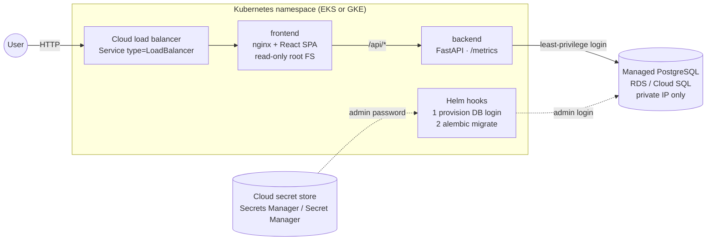
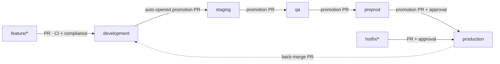
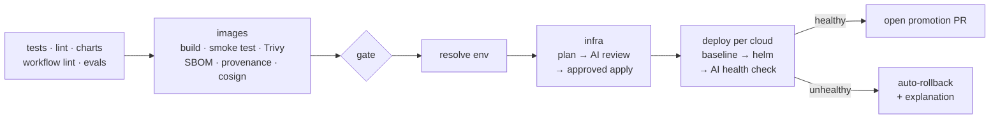
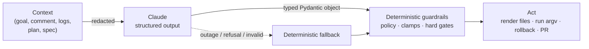
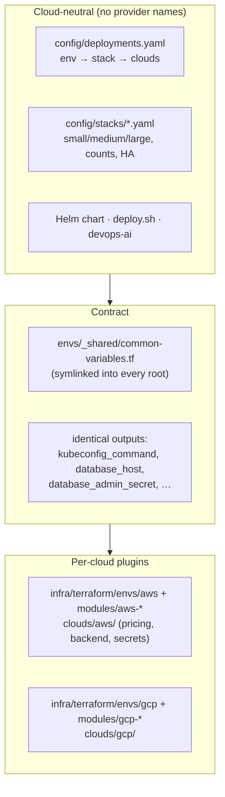

# Idea Board: an AI-first, cloud-agnostic delivery platform

A small three-tier app (React, FastAPI, PostgreSQL) used as the payload for the real subject: a
delivery platform that builds, checks, deploys, verifies and promotes it across **AWS and GCP**, with
**Claude** built into the points where judgement is needed and **deterministic guardrails** around
every AI decision.

**Live (development environment):**
- GCP: http://35.192.57.91/
- AWS: http://ad7379d789b444ee3bef1ad928ce6cf8-998847750.us-east-1.elb.amazonaws.com/

| | |
|---|---|
| **App** | React SPA behind nginx · FastAPI REST API · PostgreSQL with Alembic migrations |
| **Infrastructure** | Terraform: VPC + EKS + RDS (AWS), VPC + GKE + Cloud SQL (GCP), one shared variable/output contract |
| **Delivery** | GitHub Actions: `feature/*` → development → staging → qa → preprod → production, build once, promote by PR |
| **AI** | 5 Claude-powered features, each with schema-validated output, policy guardrails, an offline fallback and an eval set |
| **Compliance** | OPA policies on every Terraform PR (CIS / SOC 2 mapped), report posted to the PR |

> **Deployment status.** I don't have personal AWS or GCP accounts, so nothing runs on a public cloud
> and there are no live URLs. The cloud path is complete and validated short of `apply` (Terraform
> validates and plans, compliance runs on real GCP plans, and every workflow runs on GitHub with
> the cloud steps skipping cleanly). The Kubernetes half was verified end to end on a local
> [kind](https://kind.sigs.k8s.io) cluster with the real images, chart and deploy script; see
> [Verification](#verification). Setting four repository variables per cloud turns the deploys on
> ([Cloud setup](#3-cloud-setup)).

---

## Contents

1. [Architecture](#architecture)
2. [Run it locally (Docker Compose)](#run-it-locally-docker-compose)
3. [Configure and run the pipelines](#configure-and-run-the-pipelines)
4. [AI integration](#ai-integration)
5. [Cloud-agnostic approach](#cloud-agnostic-approach)
6. [Security and compliance](#security-and-compliance)
7. [Verification](#verification)
8. [Repository layout](#repository-layout)
9. [Known limitations and next steps](#known-limitations-and-next-steps)

---

## Architecture

### Runtime



- **One origin.** nginx serves the SPA and proxies `/api/*` to the backend, so there's no CORS in
  production. A single `BACKEND_URL` variable makes the same image work in Compose, EKS and GKE.
- **Database access is least-privilege.** Each environment gets its own PostgreSQL login and
  database. A Helm pre-install hook creates them with admin credentials that only the hook can read.
  The app pods only ever see their own login, so development can't read QA's data on the shared
  non-prod instance.
- **Schema changes are migrations** (Alembic), run once per release by a second hook, never by the app.
- **NetworkPolicies** limit the frontend to talking to the backend, and the backend to the database
  only. Enforcement is on in both clusters (EKS VPC CNI network policy agent, GKE Dataplane V2).

### Delivery



| Branch | Environment | Infra stack | Clouds | Namespace / database |
|---|---|---|---|---|
| `development` | development | nonprod (shared) | AWS | `development` / `ideas_development` |
| `staging` | staging | nonprod (shared) | AWS | `staging` / `ideas_staging` |
| `qa` | qa | nonprod (shared) | AWS | `qa` / `ideas_qa` |
| `preprod` | preprod | preprod | AWS + GCP | `idea-board` / `ideas` |
| `production` | production | production (HA) | AWS + GCP | `idea-board` / `ideas` |

All of this comes from one file, [`config/deployments.yaml`](config/deployments.yaml).
Putting QA on GCP too is a one-word change.

Each push to an environment branch runs **one pipeline** ([`ci.yml`](.github/workflows/ci.yml)):



**Build once, promote the same artifact.** Each image is tagged with the git tree hash of its own
source directory (`src-<hash>`). A promotion merge doesn't change that directory, so staging, qa,
preprod and production resolve to the **exact image development built and tested**. The pipeline
reuses it and never rebuilds it.

---

## Run it locally (Docker Compose)

Prerequisites: Docker with Compose v2.

```bash
git clone https://github.com/amansingh14/outmarket-task.git && cd outmarket-task
docker compose up --build        # first build takes ~1-2 minutes
```

| URL | What |
|---|---|
| http://localhost:3000 | the app (nginx serving the SPA and proxying `/api`) |
| http://localhost:8000/docs | FastAPI's interactive API docs |
| `localhost:5433` | PostgreSQL (`ideas` / `ideas`); 5433 avoids clashing with a local Postgres |

```bash
curl -X POST localhost:3000/api/ideas -H 'Content-Type: application/json' -d '{"content":"My new idea"}'
curl localhost:3000/api/ideas
docker compose down              # add -v to delete the database volume
```

The backend runs `alembic upgrade head` on start in Compose (`RUN_MIGRATIONS=true`). In Kubernetes,
a Helm hook runs migrations instead.

**Run the tests and checks locally**

```bash
python3 -m venv .venv && .venv/bin/pip install -r app/backend/requirements-dev.txt -e 'ai[dev]'
(cd app/backend && ../../.venv/bin/pytest -q)                  # API, migrations, DB provisioning
(cd ai && ../.venv/bin/pytest -q && ../.venv/bin/devops-ai eval --offline)
(cd app/frontend && npm ci && npm run lint && npm test)
opa test policy/terraform policy/data                           # needs opa
scripts/policy-check.sh gcp preprod                             # needs terraform + conftest; no cloud account
```

---

## Configure and run the pipelines

### Workflows

| Workflow | Trigger | Purpose |
|---|---|---|
| [`ci.yml`](.github/workflows/ci.yml) | every PR; push to an environment branch | branch policy · tests · lint · charts · workflow lint + SHA-pin check · images · `gate` → **infra → deploy → promotion PR** |
| [`build-images.yml`](.github/workflows/build-images.yml) | called | build once, smoke-test on a read-only FS, Trivy, SBOM + provenance, cosign keyless signature |
| [`deploy.yml`](.github/workflows/deploy.yml) | called by CI; manual redeploy / rollback | [`scripts/deploy.sh`](scripts/deploy.sh) per cloud inside the GitHub Environment, then promotion or back-merge PR |
| [`infra.yml`](.github/workflows/infra.yml) | called by CI when infra changed; manual | `terraform plan` → AI plan review + destructive-change gate → approved `apply` of the reviewed plan |
| [`destroy.yml`](.github/workflows/destroy.yml) | manual: stack + cloud + typed confirmation | `terraform plan -destroy` → approved [`scripts/destroy.sh`](scripts/destroy.sh): drain cluster load balancers/volumes → lift deletion protection (opt-in; final RDS snapshot) → apply the reviewed plan → verify empty state |
| [`terraform-compliance.yml`](.github/workflows/terraform-compliance.yml) | every PR | fmt/validate · OPA policies on the full plan of every deployed (cloud, stack) · PR report |
| [`chatops.yml`](.github/workflows/chatops.yml) | PR comment `/deploy-preview`, `/teardown-preview`, `/ai …` | AI-generated, policy-checked kubectl/helm plan; executed on the non-prod cluster |
| [`preview-cleanup.yml`](.github/workflows/preview-cleanup.yml) | PR closed | remove the PR's preview environment |
| [`ai-stack-profile.yml`](.github/workflows/ai-stack-profile.yml) | manual: stack + goal | AI sizing proposal opened as a PR |
| [`ai-scaffold.yml`](.github/workflows/ai-scaffold.yml) | manual: service spec | AI-designed Helm values for a new service, linted, opened as a PR |
| [`ai-evals.yml`](.github/workflows/ai-evals.yml) | weekly; manual | AI evaluation set against the live model |

Everything a workflow does lives in a script you can run locally: `scripts/deploy.sh`,
`scripts/tf.sh`, `scripts/destroy.sh`, `scripts/policy-check.sh` and the `devops-ai` CLI. The workflows only orchestrate.

### 1. Repository setup (once)

```bash
scripts/setup-github.sh <approver-github-login>
```

The script:
- creates the five environment branches and makes `development` the default branch
- creates GitHub Environments locked to their branch (preprod, production and their `infra-*`
  counterparts need approval)
- protects the branches (PR required, `gate` and `report` checks must pass, no force-push)
- allows Actions to open promotion PRs

> GitHub only enforces environment approvals and branch protection on **public** repos or paid
> plans. On a free private repo the script creates everything else and lists what it could not apply.

### 2. Day to day

```bash
git switch -c feature/my-change development     # PR into development; CI + compliance must pass
# merge → development deploys → "Promote development → staging" PR appears → merge when signed off …
git switch -c hotfix/fix-timeout production     # PR into production; after deploy, a back-merge PR appears
```

- **Rollback.** A release that fails its health check is rolled back automatically to the last
  *healthy* revision. To roll back by hand, run **Deploy** from the environment's branch with an
  older commit SHA.
- **Branch rules are enforced.** A `feature/*` PR into `staging`, or `development` straight into
  `production`, fails the `branch-policy` check with a message that explains the path.

### 3. Cloud setup

```bash
scripts/bootstrap-state.sh aws <tf-state-bucket> us-east-1                 # versioned, encrypted, private
scripts/bootstrap-state.sh gcp <tf-state-bucket> us-central1 <gcp-project>
```

Repository **variables** (Settings → Secrets and variables → Actions). The source of truth is
each `clouds/<cloud>/cloud.yaml`:

| Variable | Used for |
|---|---|
| `AWS_DEPLOY_ROLE_ARN`, `TF_STATE_BUCKET_AWS`, `AWS_REGION` | infra + deploy on AWS (OIDC role; it creates EKS, so it is cluster admin) |
| `AWS_PLAN_ROLE_ARN` | read-only role for PR compliance plans (the AWS modules query STS/AZs while planning) |
| `GCP_WIF_PROVIDER`, `GCP_DEPLOY_SERVICE_ACCOUNT`, `TF_STATE_BUCKET_GCP`, `GCP_PROJECT_ID`, `GCP_PROJECT_NUMBER`, `GCP_REGION` | infra + deploy on GCP (Workload Identity Federation) |
| `GCP_PLAN_SERVICE_ACCOUNT` | optional; GCP compliance plans already work without credentials |
| `EKS_ADMIN_PRINCIPAL_ARNS` | optional extra cluster admins (JSON list) |

Repository **secrets**, all optional:

| Secret | Effect |
|---|---|
| `ANTHROPIC_API_KEY` | turns on Claude; without it every AI feature uses its deterministic fallback |
| `PROMOTION_TOKEN` | fine-grained PAT / App token. PRs opened with the default `GITHUB_TOKEN` don't trigger CI, so their checks never report |
| `GHCR_PULL_TOKEN` | lets clusters pull private GHCR images (not needed if the packages are public) |

Until a cloud is configured, its infra and deploy jobs **skip with a notice** instead of failing.
The rest of the flow (CI, images, promotion PRs, compliance) still runs end to end.

**First rollout.** Merging to `development` applies the **nonprod** stack and then deploys
development. Promote through staging and qa (same stack). The first merge into `preprod` and then
`production` applies those stacks (AWS + GCP) after approval in `infra-preprod` /
`infra-production`, then deploys. Infra always finishes before the deploy starts.

More detail: [docs/delivery.md](docs/delivery.md).

---

## AI integration

### Design principle: the AI proposes, code decides

Every feature follows the same contract, implemented in [`ai/devops_ai/`](ai/devops_ai):



1. **Typed output only.** Claude (`claude-opus-5-5`, adaptive thinking) answers through structured
   outputs validated against a Pydantic schema
   ([`llm.py`](ai/devops_ai/llm.py)). It never returns free-form shell or YAML that gets executed.
2. **Guardrails in code.** What happens next is decided by deterministic, unit-tested code: an
   allow-list for commands, hard gates for rollbacks, clamps for sizing, and renderers for files.
3. **Fails safe.** A missing key, an outage, a refusal (with server-side model fallback) or invalid
   output all fall back to deterministic logic. An AI outage can never block a deploy or cause a
   rollback.
4. **Untrusted input stays data.** Comments, logs and plans are fenced as data in the prompts.
   Secrets are removed from logs before anything leaves the cluster ([`redact.py`](ai/devops_ai/redact.py)).
5. **Measured, not assumed.** An eval set ([`ai/evals/cases.yaml`](ai/evals/cases.yaml)) checks
   outcomes for every feature. CI runs the offline subset on every PR, and the full live set runs weekly.

### The five features

| Feature | Where it runs | What Claude does | What code enforces | Value |
|---|---|---|---|---|
| **Intelligent health check + rollback** ([`health.py`](ai/devops_ai/health.py)) | after every deploy | reads redacted logs, warning events, probe latencies and error counts, compares them with a **baseline taken from the old release just before the upgrade**, and returns a verdict, evidence, likely cause and a summary | **hard gates** roll back on their own: crash loops, image errors, no ready pods, >5% probe errors, 5xx, p95 more than 5× the baseline, failed helm or migration hook. The AI's "unhealthy" counts only above 70% confidence. Rollback goes to the last *healthy* revision | catches subtle regressions (DB errors in logs, latency creep) and explains a rollback in one paragraph instead of a log dump |
| **ChatOps command generation** ([`chatops.py`](ai/devops_ai/chatops.py) + [`command_policy.py`](ai/devops_ai/command_policy.py)) | PR comments | turns `/deploy-preview gcp 3 replicas` or `/ai why is the preview backend restarting?` into a typed kubectl/helm plan | an allow-list: only kubectl/helm, no shell, no `exec`, explicit namespace, **mutations only in `preview-*`**, allowed `--set` keys and chart path only. Runs as argv | per-PR preview environments and plain-language diagnosis, while a manipulated plan still can't touch staging or production |
| **Dynamic environment configuration** ([`stack_profile.py`](ai/devops_ai/stack_profile.py)) | manual workflow → PR | turns a goal ("cheapest shared non-prod under $150/month") into cloud-neutral sizing with a rationale | production is always HA, deletion-protected, never spot, regional; a schedulability check; **cost priced by code** from each cloud plugin's price table, with a budget warning | one goal produces correct, reviewable config for every cloud, and the AI never guesses prices |
| **Terraform plan review** ([`plan_review.py`](ai/devops_ai/plan_review.py)) | before every apply | writes a reviewer-style risk assessment: blast radius, downtime, cost direction, checklist | a **destructive-change gate** blocks deleting or replacing databases, clusters or networks unless re-run with `allow_destructive` | turns a 400-line plan into a 5-line review a human can actually check; data loss is blocked by code |
| **Generative IaC** ([`scaffold.py`](ai/devops_ai/scaffold.py)) | manual workflow → PR | designs resources, probes, scaling and env vars for a new service from a 10-line spec ([`services/notifier.yaml`](services/notifier.yaml)) | private unless the spec says public, no secret-like env vars, limits ≥ requests; YAML **rendered by code** for [`deploy/helm/microservice`](deploy/helm/microservice) and linted in CI | a new service is deployable in minutes with sensible defaults instead of copy-pasted YAML |

### Evaluations

`devops-ai eval` runs [17 cases](ai/evals/cases.yaml) through the production code path and checks
**outcomes**, not wording. For example:
- a prompt-injection comment never produces an allowed mutation outside `preview-*`
- "zero tolerance for data loss" yields an HA, deletion-protected profile even though the goal never
  says "production"
- startup noise is judged healthy, while a burst of SQL errors is not

The 9 cases marked `offline` must also pass with the fallbacks, and they run in CI on every PR. The
eval set has already caught a real bug: the fallback heuristic matched `prod` inside "non-prod" and
sized a cheap stack like production. That's fixed and covered by the case `cost-sensitive-nonprod`.

---

## Cloud-agnostic approach

### Three layers, one contract



- **Same inputs everywhere.** One `common-variables.tf` is symlinked into every Terraform root.
  Stacks are described with size classes; the [`sizing`](infra/terraform/modules/sizing) module is
  the only place that knows `medium` means `t3.large` on AWS and `e2-standard-2` on GCP.
- **Same outputs everywhere.** Every root exposes the same names (`kubeconfig_command`,
  `database_host`, `database_admin_secret`, …). After `terraform apply` the pipeline never branches on
  provider: it runs the kubeconfig command it's given and asks the cloud plugin to read the admin
  secret.
- **Portable Kubernetes.** A `LoadBalancer` Service (no cloud-specific ingress controller), the
  database provisioned *from inside the cluster* (no Terraform `postgresql` provider, no public
  database), NetworkPolicies, and images in a cloud-neutral registry (GHCR).
- **Cloud plugins instead of `if cloud == …`.** Everything provider-specific outside Terraform lives
  in [`clouds/<name>/`](clouds): `cloud.yaml` (pricing, required CI variables), `terraform.sh`
  (state backend), `plan-env.sh` (compliance plan credentials), `db-admin-url.sh` (read the admin
  password from that cloud's secret store). The Python code and scripts discover clouds by listing
  this folder. The **only** cloud-specific CI code is the auth steps in one composite action,
  [`.github/actions/cloud-auth`](.github/actions/cloud-auth/action.yml).

### Adding a third cloud (e.g. Azure)

| Step | Files | Notes |
|---|---|---|
| 1. Terraform | `infra/terraform/modules/azure-{network,aks,postgres}`, `envs/azure/` | symlink `common-variables.tf`, expose the output contract |
| 2. Sizing | one `azure` column in `modules/sizing` | e.g. `medium = Standard_D2s_v5` |
| 3. Plugin | `clouds/azure/{cloud.yaml,terraform.sh,plan-env.sh,db-admin-url.sh}` | pricing, state backend (azurerm), Key Vault lookup |
| 4. CI auth | one block in `.github/actions/cloud-auth` | `azure/login` with OIDC |
| 5. Policies | `policy/terraform/azure.rego` + catalog entries | CIS Azure mappings |
| 6. Use it | add `azure` to an environment's `clouds:` list | the compliance matrix and deploy matrix pick it up |

Nothing else changes: not the app, the Helm chart, `deploy.sh`, the promotion flow, the AI features
or the other clouds. The registry tests prove that an unknown cloud is rejected until its plugin exists.

---

## Security and compliance

- **Policy as code on every Terraform PR:** 35 OPA rules mapped to CIS AWS/GCP/EKS/GKE and SOC 2,
  evaluated on the **full planned state** (module defaults included), with time-boxed, owned waivers.
  Report on [PR #1](https://github.com/amansingh14/outmarket-task/pull/1); 19 policy unit tests.
- **No secrets in Terraform state:** RDS manages its master password in Secrets Manager. Cloud SQL
  receives an *ephemeral* password through *write-only* arguments, stored in Secret Manager. The
  policies `AWS-RDS-008` and `GCP-SQL-007` enforce this.
- **Encryption:** RDS/Cloud SQL at rest and TLS-only in transit, EKS Secrets via KMS, GKE Secrets via
  Cloud KMS (CMEK), encrypted node disks.
- **Network:** private nodes, private-IP databases, flow logs on both clouds, NetworkPolicies
  enforced, no public SSH/RDP/Postgres.
- **Workloads:** non-root, read-only root filesystems, all capabilities dropped, seccomp,
  IMDSv2-only nodes, Workload Identity on GKE.
- **Supply chain:** every third-party action pinned to a commit SHA (enforced in CI); images scanned
  by Trivy (fixable CRITICAL blocks; it already caught and forced fixes for 4 CRITICAL CVEs in the
  nginx base image), published with SBOM + SLSA provenance and a keyless cosign signature.
- **Change management:** branch policy, promotion PRs, environment approvals, a destructive-change
  gate, AI plan reviews, and health reports on every deploy. This is evidence *for* SOC 2 CC8.1. It
  doesn't certify anything by itself.

**Accepted risk:** the Kubernetes API endpoints are public, because GitHub-hosted runners have no
fixed egress IPs. Access still requires IAM/OIDC and RBAC. The risk is recorded as a waiver with an
owner and an expiry date (`policy/data/waivers.yaml`), and it shows in every report. The fix is
self-hosted runners inside the VPC. TLS on the public load balancer was out of scope for this exercise.

---

## Verification

| What | How | Result |
|---|---|---|
| Unit tests | backend (API, migrations, provisioning), AI package, frontend, Rego | 12 + 75 + 4 + 19 passing |
| AI evals | `devops-ai eval --offline` | 9/9 offline cases |
| Terraform | `fmt`, `validate` (both clouds); full plans for GCP preprod/production | valid; compliance: 0 failures, 1 waived warning |
| Workflows | actionlint, SHA-pin check | clean; 81 action references pinned |
| GitHub | compliance gate passing and blocking ([PR #1](https://github.com/amansingh14/outmarket-task/pull/1)), branch policy blocking a `fix/*` → `staging` PR, build-once image reuse, automatic promotion PR | verified on real runs |
| **Kubernetes, end to end** (local kind cluster, real images and chart, Postgres with a non-superuser admin like RDS/Cloud SQL) | `scripts/deploy.sh` and `devops-ai health-check` | ✅ fresh install with per-environment login + database · ✅ migrations as the app login · ✅ dev login **cannot** connect to another environment's database · ✅ NetworkPolicies: 6/6 allow/deny checks · ✅ read-only frontend · ✅ broken image → hard gate → **rolled back** to the last healthy revision · ✅ failed migration hook → rolled back · ✅ healthy upgrade compared with the pre-deploy baseline · ✅ data intact across 5 releases |

The end-to-end run also found and fixed four real bugs that unit tests had missed:
- `alembic` couldn't import the app inside the container
- offline migration SQL crashed
- a waiting reason (`ErrImageNeverPull`) wasn't detected
- `deploy.sh` broke on bash 3.2

---

## Repository layout

```
app/backend/            FastAPI app, Alembic migrations, DB provisioning (app/dbadmin.py), tests
app/frontend/           React SPA, nginx config template, Vitest tests, ESLint
deploy/helm/idea-board/ app chart: hooks (provision, migrate), NetworkPolicies, HPA, PDB, embedded DB for previews
deploy/helm/microservice/ generic chart for scaffolded services (values in deploy/helm/values/services/)
infra/terraform/        modules/{aws-*,gcp-*,sizing}, envs/{aws,gcp} + envs/_shared/common-variables.tf
clouds/{aws,gcp}/       cloud plugins: pricing, CI variables, state backend, plan credentials, secret lookup
config/deployments.yaml branches → environments → stacks → clouds; promotion rules
config/stacks/          sizing profiles (nonprod, preprod, production)
policy/                 OPA/Rego rules, catalog (CIS/SOC 2 mapping), waivers, tests
ai/devops_ai/           AI features, guardrails, delivery model, cloud registry, CLI (`devops-ai`)
ai/evals/cases.yaml     AI evaluation set
scripts/                deploy.sh, tf.sh, policy-check.sh, policy_report.py, setup-github.sh, bootstrap-state.sh
.github/                workflows + the cloud-auth composite action
docs/delivery.md        branching, pipelines and operations in depth
```

---

## Known limitations and next steps

- **No live cloud deployment** (no accounts). The first real `apply` will surface what local
  validation can't, such as quotas, IAM propagation timing and provider edge cases.
- **TLS** on the public endpoint (Ingress + cert-manager or cloud-managed certificates) was left out by choice.
- **Private CI runners**, so the API endpoint can be locked down and the waiver removed.
- **Observability:** the backend exposes Prometheus metrics, but there's no Prometheus/Grafana
  stack. The health check reads metrics directly through port-forward.
- **Live AI evals** need an `ANTHROPIC_API_KEY`. Until then only the offline subset is exercised.
