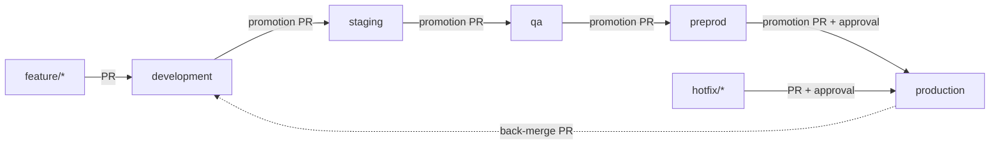

# Branching, build and deployment

All of this is driven by [`config/deployments.yaml`](../config/deployments.yaml). Pipelines read it
through `devops-ai delivery …`, so changing where an environment runs (for example adding GCP to QA)
is a one-line PR.

## Branches and environments



| Branch | Environment | Infra stack | Clouds | Namespace | Database | Deploy gate |
|---|---|---|---|---|---|---|
| `development` | development | nonprod | AWS | `development` | `ideas_development` (shared instance) | automatic |
| `staging` | staging | nonprod | AWS | `staging` | `ideas_staging` (shared instance) | automatic |
| `qa` | qa | nonprod | AWS | `qa` | `ideas_qa` (shared instance) | automatic |
| `preprod` | preprod | preprod | AWS + GCP | `idea-board` | dedicated | approval |
| `production` | production | production | AWS + GCP | `idea-board` | dedicated, HA | approval |

- **nonprod** is one cluster and one database instance (per cloud) shared by development, staging and
  qa. Each environment gets its own namespace and its own database. A Helm hook creates the
  database on first deploy.
- **preprod** has production's shape at lower scale. **production** is HA (Multi-AZ / regional DB,
  regional control plane, deletion protection).
- Branch rules are enforced by the `branch-policy` CI job. A `feature/*` PR into `staging` fails,
  and so does `development` → `production` (no skipping environments).

Short-lived branch prefixes: `feature/`, `fix/`, `chore/`, `docs/`, `refactor/`, `test/` (into
`development`), `hotfix/` (into `production`).

## Pipelines

| Workflow | Trigger | What it does |
|---|---|---|
| [`ci.yml`](../.github/workflows/ci.yml) | every PR, every push to an env branch | branch policy · backend lint+tests · frontend build · AI tests · Helm lint/render for all 5 envs · image build + Trivy scan · single `gate` check |
| [`build-images.yml`](../.github/workflows/build-images.yml) | called by CI and Deploy | builds each image **once**, tagged `src-<tree hash of its source dir>`; existing tags are reused, never rebuilt |
| [`deploy.yml`](../.github/workflows/deploy.yml) | CI succeeded on a push to an env branch; or manual | resolve env → deploy to each of its clouds (in the GitHub Environment) → AI health check with auto-rollback → open/update the promotion PR |
| [`infra.yml`](../.github/workflows/infra.yml) | push to `development` / `preprod` / `production` touching infra; or manual | `terraform plan` → AI plan review + destructive-change gate → apply in `infra-<stack>` environment |
| [`terraform-compliance.yml`](../.github/workflows/terraform-compliance.yml) | every PR (heavy jobs only if infra changed) | fmt/validate · OPA policies on the full plan of each stack · PR report |

### Build once, promote the same artifact

Images are tagged with `git rev-parse HEAD:app/backend` (and `app/frontend`), the tree hash of the
image's own source directory. A promotion merge doesn't change that directory's contents, so
staging, qa, preprod and production resolve to the **same tag** that development built and tested.
The deploy job reuses it and never rebuilds per environment. A `sha-<commit>` alias is added for
traceability.

### Promotion

After an environment deploys and passes its health check on every cloud, the pipeline opens (or
updates) a PR to the next branch. The PR lists the deployment results per cloud, the image tags and
the commit changelog. A person reviews and merges it, and that merge deploys the next environment.
preprod and production also wait for an approval in their GitHub Environment.

If production gains changes development lacks (a hotfix), the pipeline opens a **back-merge** PR
`production → development`.

## Day-to-day

**Ship a feature**
1. `git switch -c feature/my-change development`, push, open a PR into `development`.
2. CI (plus the compliance report if you touched Terraform) must be green. Merge.
3. development deploys automatically, then a `Promote development → staging` PR appears.
4. Merge promotion PRs as each environment is signed off. preprod and production ask for approval.

**Hotfix**
1. `git switch -c hotfix/fix-timeout production`, PR into `production`, approve, merge.
2. After production deploys, the back-merge PR into `development` appears. Merge it so the fix
   ships with the next release.

**Roll back**
- Automatic: a deploy that fails the health check is rolled back to the previous Helm revision, and
  promotion stops.
- Manual: run **Deploy** (Actions → Deploy → Run workflow) with the environment and an older commit
  SHA, or `helm rollback idea-board -n <namespace>`.

**Change infrastructure**: edit `infra/terraform/**` or a sizing profile in
`config/environments/`. The PR shows the compliance report. Merging into `development` applies
nonprod; the change reaches preprod/production when promoted there, after approval in
`infra-preprod` / `infra-production`.

## Setup

### 1. Repository (once)

```bash
scripts/setup-github.sh <approver-github-login>
```

This creates the five branches, sets `development` as the default branch, creates the GitHub
Environments (approvals on preprod, production, infra-preprod, infra-production), protects every
environment branch (PR required, `gate` and `report` checks must pass, no force-push) and allows
Actions to open PRs.

> Environment approvals and branch protection on **private** repos need a paid GitHub plan; on a
> free private repo the script creates everything and reports what it could not protect. Public
> repos get them for free.

### 2. Cloud setup

State buckets (once, admin credentials):

```bash
scripts/bootstrap-state.sh aws <tf-state-bucket> us-east-1
scripts/bootstrap-state.sh gcp <tf-state-bucket> us-central1 <gcp-project>
```

Repository **variables** (Settings → Secrets and variables → Actions → Variables):

| Variable | Used by | Example |
|---|---|---|
| `AWS_DEPLOY_ROLE_ARN` | infra + deploy (OIDC role; creates EKS so it is cluster admin) | `arn:aws:iam::123456789012:role/idea-board-deploy` |
| `AWS_PLAN_ROLE_ARN` | PR compliance (read-only) | `arn:aws:iam::123456789012:role/idea-board-plan` |
| `AWS_REGION` | all | `us-east-1` |
| `TF_STATE_BUCKET_AWS` | infra + deploy | `acme-idea-board-tfstate` |
| `GCP_WIF_PROVIDER` | all GCP jobs | `projects/123/locations/global/workloadIdentityPools/github/providers/github` |
| `GCP_DEPLOY_SERVICE_ACCOUNT` | infra + deploy | `idea-board-deploy@acme.iam.gserviceaccount.com` |
| `GCP_PLAN_SERVICE_ACCOUNT` | PR compliance (optional; GCP plans work without it) | `idea-board-plan@acme.iam.gserviceaccount.com` |
| `GCP_PROJECT_ID` / `GCP_REGION` | all GCP jobs | `acme-idea-board` / `us-central1` |
| `TF_STATE_BUCKET_GCP` | infra + deploy | `acme-idea-board-tfstate` |
| `EKS_ADMIN_PRINCIPAL_ARNS` | infra (optional) | `["arn:aws:iam::123456789012:role/platform-admins"]` |

Repository **secrets**:

| Secret | Why |
|---|---|
| `ANTHROPIC_API_KEY` | AI health checks and plan reviews. Optional: without it they fall back to deterministic checks. |
| `PROMOTION_TOKEN` | Fine-grained PAT or GitHub App token (contents + pull requests: write). PRs opened with the default `GITHUB_TOKEN` **do not trigger CI**, so their required checks never report. Without this token, re-run CI on promotion PRs by hand. |
| `GHCR_PULL_TOKEN` | PAT with `read:packages`, so clusters can pull private GHCR images. Not needed if the packages are public. |

Until a cloud is configured, its deploy and infra jobs **skip with a notice** instead of failing.
The flow (CI → build → promotion PRs) still works end to end, which is how you test the branching
model before spending money on clusters.

### 3. First deploy order

1. Merge to `development` → `infra.yml` applies the **nonprod** stack (AWS).
2. `deploy.yml` deploys development; promote through staging and qa (same stack, nothing to apply).
3. Promoting to `preprod` applies the **preprod** stack (AWS + GCP) after `infra-preprod` approval,
   then deploys. Same for `production`.

On the very first push to an environment, infra and deploy run in parallel and the deploy may find
no cluster yet. Re-run **Deploy** for that environment once the infra apply finishes.
